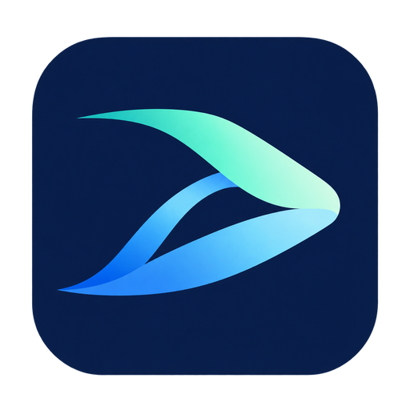

# 光梭 / GlideBeam

**面向局域网桌面办公的原生 Windows 控制 Mac 软件。**

[English](README.md) · [下载](https://github.com/dixtdf/GlideBeam/releases) · [构建说明](docs/building.md) · [兼容性](docs/compatibility.md)

光梭采用 Windows 本地光标、独立键鼠通道、Mac H.264 编码与 Windows GPU 解码。Mac 优先硬件编码，不可用时回退到 Apple 软件编码器。双端原生扁平界面提供 **简体中文、English、跟随系统**，分别保存语言偏好。

## 已有功能

- Windows 11 原生客户端和 macOS 主机端；真正全屏、顶部自动隐藏工具栏、可拖动且限制在窗口内的状态浮窗。
- Mac 使用 ScreenCaptureKit 采集、VideoToolbox H.264 编码；优先硬件，不可用时软件回退并限制到 30 FPS。Windows 使用 Media Foundation / D3D11 硬件解码和 GPU 呈现。
- Mac 系统声音传到 Windows（0.3.0，需更新双端）：5 ms PCM 音频包、独立 WASAPI 播放线程、自适应缓冲与时钟漂移补偿；支持静音及输出设备恢复。传输信息显示音频缓冲、声卡周期、欠载和丢包，详见[音频说明](docs/audio.md)。
- 地址加一个可自定义、持久保存的配对令牌。同一 IP 连续 10 次完整错误令牌验证后封禁，Mac 界面可解除封禁。
- 双向 Unicode 文本和图片剪贴板；复制粘贴、拖拽和文件面板传输文件及文件夹。支持进度、暂停、继续、取消与 SHA-256 校验。
- 双端轮转日志、Mac 登录后自启，以及经过配对鉴权和系统管理员授权的 Mac 重启功能。

当前覆盖已登录的单屏 Mac 桌面与局域网。尚未实现麦克风转发、富文本、目录镜像、登录前控制或公网中继。视频使用 H.264，不承诺 HEVC 支持。

[v1.0.0](https://github.com/dixtdf/GlideBeam/releases/tag/v1.0.0) 新增 Windows Setup 安装程序，继续提供便携 ZIP，保留 0.3.0 的系统音频和诊断功能；从 0.2.1 更新时请同时更新双端。安装方式与验证范围见 [1.0.0 发布说明](https://github.com/dixtdf/GlideBeam/blob/v1.0.0/docs/releases/1.0.0.md)。

## 开始使用

1. 按两台电脑的架构下载发行包。Windows 的 Intel/AMD 电脑运行 `GlideBeam-1.0.0-Windows-x64-Setup.exe`，ARM 电脑选择 ARM64 Setup，也可继续使用便携 ZIP；Mac ZIP 包含 `GlideBeam Host.app`。
2. 打开 Mac 端，在系统设置允许「屏幕录制」和「辅助功能」。必要时使用「设置屏幕与输入权限」「重试画面采集」。需要可用的 Mac 桌面和显示器采集源。
3. 复制 Mac 窗口显示的地址与完整配对令牌，在 Windows 客户端填写并连接。默认端口为 **UDP 47990**，需要局域网放行。VNC 密码不能代替光梭的配对令牌。
4. 将鼠标移到远控窗口顶部中央即可显示工具栏，打开文件传输、统计、日志或重启控制。关闭 Mac 连接窗口后，主机端仍在菜单栏运行。

两端可分别选择「跟随系统」「English」「简体中文」。Windows 入口为「偏好设置 → 界面语言」，连接后也可在「更多 → 语言」切换；Mac 窗口顶部和菜单均提供入口。「登录后自动启动」在该用户进入 macOS 桌面后运行，不提供登录前控制。

Windows Setup 支持简体中文和 English，仅为当前用户安装到 `%LOCALAPPDATA%\Programs\GlideBeam`，无需管理员权限。安装时创建开始菜单快捷方式，桌面快捷方式可选。运行新版 Setup 即可升级，在 Windows「已安装的应用」中卸载；升级和卸载均保留 `%LOCALAPPDATA%\RemoteNative` 中的设置及配对资料。Windows 程序和安装包尚未签名。便携版请完整解压到同一目录，运行 `GlideBeam.exe` 或 `Start-GlideBeam.cmd`。

断开连接只释放远端键鼠状态，**不会主动锁定 Mac**。macOS 自身的屏保、睡眠和密码设置仍然生效。

公开名称为「光梭 / GlideBeam」。为兼容早期开发版，保留 `RemoteNative` 配置路径与 Mac bundle identifier。Windows 配对资料使用当前用户的 DPAPI 保存，Mac 设置和身份位于 `~/Library/Application Support/RemoteNative`。请勿将这些私人目录加入源码仓库。

## 实测配置与兼容范围

**不保证兼容其他硬件、驱动、虚拟机和系统版本。** 硬件加速依赖实际可用的系统采集、编解码接口及驱动；产物能构建不代表真机采集、编码、解码与输入均已验证。

| 项目 | 实测 Windows 客户端 | 实测 Mac 主机端 |
| --- | --- | --- |
| 系统 | Windows 11 Pro，build 26300 | macOS 15.8.1，build 24H32 |
| CPU | Intel Core i3-10100F，3.60 GHz | Unraid x64 虚拟机，20 个逻辑 CPU；来宾报告 Genuine Intel CPU 0000，3.30 GHz |
| 内存 | 16 GB | 虚拟机分配 16 GiB |
| 显卡 | Radeon RX Vega，驱动 31.0.12027.9001 | 直通 RTX 3060 12 GB |
| 显示与视频 | 本机显示器 2560 × 1440 | 远端采集 1920 × 1080，H.264 NVENC |
| 补充 | 原生 x64 客户端 | 使用实验性 [nullmoth/nvidia-macos-driver](https://github.com/nullmoth/nvidia-macos-driver) |

实体虚拟机宿主配置由使用者提供：Intel Core i9-10900K ES QTB2、ASRock B460M Pro4S/ac，Above 4G Decoding 已开启。宿主 CPU 与来宾暴露的 CPU 身份不同。

Windows x64 与 Intel Mac 已在上述环境进行实际会话验证。**Windows ARM64、Apple Silicon 为构建目标，尚未在对应实体设备验证。** Mac 部署最低版本为 15.2，实测为 15.8.1。发行包**不包含 NVIDIA 驱动**，该实验驱动的表现只代表所列环境。更多边界和限定范围的 NVENC 布局补偿见[兼容性说明](docs/compatibility.md)。

60 FPS 是帧调度目标，不是交付帧率或输入延迟保证。

## 构建与发布

[构建说明](docs/building.md)覆盖 Windows x64 / ARM64 与 Mac Intel / Apple Silicon。项目使用 C++20、Objective-C++ 和 Rust QUIC 传输；版本取自 `VERSION`，依赖由 `Cargo.lock` 锁定，Rust 编译器由 `rust-toolchain.toml` 锁定。

[GitHub Actions](.github/workflows/build.yml)在 push、PR 和手动运行时构建四架构 ZIP 与两个 Windows Setup。推送与 `VERSION` 匹配的 `v<VERSION>` 标签后，所有构建通过才准备 **Draft Release**，包含四个 ZIP、两个 Setup EXE 和 `SHA256SUMS.txt`。CI 检查 x64 安装、同版本修复、卸载及离线测试和架构，不会执行真实桌面会话或实体 ARM64 验收。触发方式和发布行为见[发布说明](docs/release.md)。

## 文档

- [剪贴板与文件传输](docs/clipboard-files.md)
- [日志、重启 Mac 与断开行为](docs/diagnostics-restart.md)
- [构建](docs/building.md)、[发布自动化](docs/release.md)
- [兼容性](docs/compatibility.md)、[Mac 签名](docs/development-signing.md)
- [传输协议](docs/transport.md)
- [系统音频、设备配置与验证](docs/audio.md)
- [低延迟、图形 API 与浏览器帧率评估](docs/performance-assessment-2026-10-11.md)
- [低延迟调度优化与测量指南](docs/latency-optimization-2026-10-11.md)
- [FPS 稳定性对照与捕获诊断工具](docs/fps-stability-2026-10-12.md)

## 许可

光梭源码和自有资源采用 [MIT](LICENSE) 许可。第三方组件保留上游许可，见 [NOTICE](NOTICE)。发行包不包含 NVIDIA 驱动、系统安装镜像、配对凭据或开发签名私钥。
